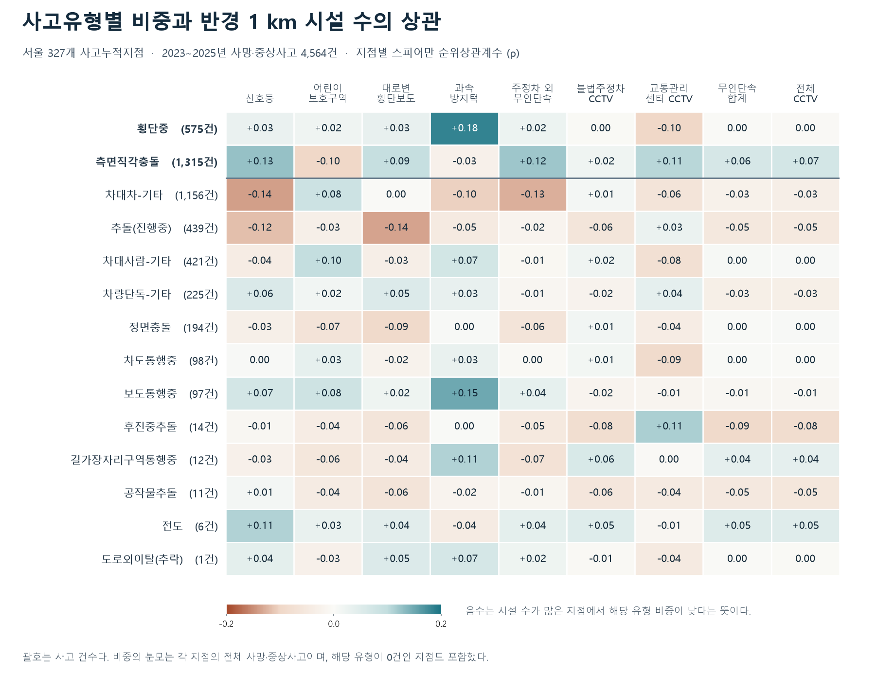

# 사고유형을 선택하면 어떤 주변 시설이 관련되어 보일까?

서울 25개 자치구의 사고누적지점 **327곳**에서 2023~2025년에 발생한 **사망·중상사고 4,564건**을 분석했다. 질문은 “이 지점에서 기록된 사망·중상사고 중 어떤 유형의 비중이 높고, 반경 1km의 어떤 시설이 그 차이와 관련되는가?”이다. 아래 수치는 관측된 사고의 **유형 구성**에 관한 결과다. 통행 한 번당 사고 위험이나 시설 설치의 예방 효과를 추정하려면 통행량과 설치 전후 자료가 필요하다. [사고별 통합 CSV](../data/processed/사고_분석용_주변시설_1000m_CCTV보완.csv)

## 1. 지점 중심 좌표에서 반경 1km 시설 피처 만들기 · 완료

02번 노트북은 사고누적지점의 중심 위도·경도에서 시설 대표점까지 거리를 계산해 1,000m 이내의 수량을 집계한다. **지점별 표에 한 번 저장하고 같은 지점의 사고 행에 연결**한다. 사고가 많은 지점을 시설이 많은 지점으로 잘못 세지 않도록, 시설 분포나 시설 간 상관을 계산할 때는 327행의 지점별 표를 사용한다. [02번 집계 노트북](../notebooks/02_count_nearby_facilities.ipynb) · [지점별 시설 CSV](../data/processed/사고다발지점_주변시설_1000m_개수.csv)

| 시설 피처 | 반경 안에서 세는 단위 |
|---|---|
| 신호등 · 어린이보호구역 | 부착대별 신호등 수량의 합 · 보호구역 대상시설 수 |
| 대로변횡단보도 · 과속방지턱 | 횡단보도 링크 수 · 험프 관리번호 수 |
| CCTV 구성 항목 | 주정차 외 무인단속 장비 대수 · 불법주정차 단속지점 수 · 교통관리센터 관제 장비 대수 |
| CCTV 합계 | 무인단속 합계는 앞의 두 단속 항목을 더한다. 전체 CCTV는 여기에 관제 장비를 더한다. 단위는 지점과 장비를 합친 **건**이다. |

## 2. 사고유형별 지도와 시각화 · 완료

기존 지도에서 **세부 유형 → 횡단중 또는 측면직각충돌**을 고르면 해당 유형이 발생한 지점이 보인다. 원의 면적은 그 지점에서 해당 유형이 차지한 비중이고, 원을 누르면 분자와 분모가 함께 나온다. 03번 노트북에서는 시설별로 지점을 ‘적음·중간·많음’으로 나누고, 구간 안의 사고 건수를 합쳐 비중을 비교한다. [사고유형 선택 지도](../outputs/서울_사고유형_지도.html) · [03번 시설 구간별 분석](../notebooks/03_compare_crash_type_shares.ipynb)

| 선택한 유형 | 전체 사망·중상사고 중 비중 | 한 건 이상 발생한 지점 | 시설이 적은 → 중간 → 많은 구간의 비중 |
|---|---:|---:|---|
| **횡단중** | 575 / 4,564건 (12.6%) | 256 / 327곳 | 과속방지턱 기준 **11.10% → 12.53% → 14.15%** |
| **측면직각충돌** | 1,315 / 4,564건 (28.8%) | 309 / 327곳 | 전체 CCTV 기준 **27.52% → 29.11% → 29.73%** |

분모를 바꾸면 질문도 달라진다. ‘보행자 사고 중 어떤 상황이 많았나?’를 묻는다면 횡단중은 **575 / 1,203건(47.8%)**이다. ‘차량 간 사고 중 옆면을 직각으로 충돌한 비중은?’을 묻는다면 **1,315 / 3,118건(42.2%)**이다. 아래 상관·회귀 분석에서는 두 유형을 비교할 수 있도록 전체 사망·중상사고를 분모로 통일했다.

## 3. 유형별 시설 상관계수 · 14개 유형 × 9개 지표 계산

각 지점에서 **선택 유형의 건수 ÷ 그 지점의 전체 사망·중상사고 건수**를 구한 뒤, 시설 수와의 스피어만 순위상관계수(ρ)를 계산했다. 327개 지점을 한 번씩 반영했고, 선택 유형이 0건인 지점도 포함했다. 기존 03번의 시설 8개 지표에 ‘주정차 외 무인단속 장비’를 따로 표시했다. 따라서 아래 그림에서 CCTV 합계와 구성 항목은 서로 겹친다. [지점별 시설 CSV](../data/processed/사고다발지점_주변시설_1000m_개수.csv) · [스피어만 계수 정의](https://docs.scipy.org/doc/scipy/reference/generated/scipy.stats.spearmanr.html)

- **횡단중**과 가장 큰 상관을 보인 시설은 과속방지턱이었다(ρ = **+0.183**). 대로변횡단보도 링크 수와의 상관은 **+0.033**이었다. 링크 수는 반경 1km의 도로 환경을 요약하므로 사고가 실제 횡단보도 위에서 났는지, 몇 명이 길을 건넜는지까지 알려주지는 않는다.
- **측면직각충돌**은 신호등 수(ρ = **+0.125**), 주정차 외 무인단속 장비 수(**+0.121**), 교통관리센터 CCTV 대수(**+0.106**)와 약한 양의 상관을 보였다. 전체 CCTV와의 상관은 **+0.070**이었다.
- 126개 조합 중 가장 큰 절댓값도 **0.183**이었다. 색이 가장 진한 셀도 강한 상관으로 해석하기 어렵다. 특히 ‘도로외이탈(추락)’은 1건, ‘전도’는 6건이어서 해당 행은 건수와 함께 읽어야 한다.

## 4. 다른 조건을 고려해도 관련성이 남는가? · 두 유형 회귀 분석 완료

**이항 로지스틱 회귀**를 유형별로 한 번씩 적합했다. 사고 한 건에서 선택 유형이면 1, 다른 유형이면 0이다. 두 모형에 같은 시설 5종과 자치구·연도·월·시각·주말 여부를 넣었다. 월과 시각은 주기성을 반영했고, 신뢰구간은 같은 지점에서 발생한 사고들의 유사성을 고려해 지점별 군집 표준오차로 계산했다. CCTV는 구성 항목과 합계가 겹쳐 전체 합계만 사용했다. 신호등 수와 횡단보도 링크 수도 지점 간 피어슨 상관이 0.79여서 두 계수는 함께 해석해야 한다. [기존 회귀 검토와 자료 기준](로지스틱_회귀_분석_검토.md)

| 시설 증가 단위 | 횡단중 오즈비 (95% 신뢰구간) | 보정 p값 | 측면직각충돌 오즈비 (95% 신뢰구간) | 보정 p값 |
|---|---:|---:|---:|---:|
| 신호등 100개 | 1.061 (0.899~1.251) | 0.807 | 0.987 (0.884~1.102) | 0.816 |
| 어린이보호구역 대상시설 5곳 | 1.143 (1.001~1.305) | 0.211 | 0.898 (0.801~1.006) | 0.211 |
| 대로변횡단보도 링크 10개 | 1.009 (0.950~1.071) | 0.816 | 1.008 (0.965~1.052) | 0.816 |
| 과속방지턱 50개 | 1.091 (0.957~1.243) | 0.482 | 0.986 (0.894~1.088) | 0.816 |
| 전체 CCTV 10건 | 0.901 (0.830~0.979) | 0.139 | 1.026 (0.957~1.101) | 0.807 |

오즈비 1은 다른 조건이 같을 때 선택 유형의 오즈(해당 유형 확률 / 다른 유형 확률)가 같다는 뜻이다. 신뢰구간은 개별 계수의 95% 구간이다. 표의 p값은 두 유형 × 시설 5종, 총 10개 시설 계수에 Benjamini–Hochberg 보정을 적용했다. **보정 p값 0.05 미만인 시설은 두 유형 모두 0개였다.** 횡단중과 전체 CCTV의 보정 전 p값은 0.014였지만 10개 비교를 함께 고려하면 0.139였다. [다중검정 보정 방법](https://www.statsmodels.org/stable/generated/statsmodels.stats.multitest.multipletests.html)

측면직각충돌은 CCTV가 가장 많은 구간에서 가장 적은 구간보다 **2.21%p** 높았다. 그러나 자치구·시간·다른 시설을 고려한 오즈비는 **1.026**이고 신뢰구간은 1을 포함한다. 이 자료에서는 CCTV가 많은 지역에서 관측된 비중 차이를 CCTV 자체의 영향으로 돌릴 근거가 부족하다. 특히 주정차·관제 CCTV에는 사고 이후인 2026년의 시설 현황이 포함된다. [CCTV 원자료 시점](../README.md)

## 5. 사고유형을 입력하면 어떤 결과를 보여줄까? · 다음 구현 제안

기존 지도의 유형 선택기에 **시설 분석 결과**를 연결한다. 사용자가 `횡단중`을 고르면 아래 네 가지를 같은 분모로 보여준다.

| 화면에 보여줄 항목 | `횡단중`을 선택한 예 |
|---|---|
| 건수와 지도 | **575 / 4,564건(12.6%)**, 발생 지점 256곳. 지점을 누르면 그 지점의 횡단중 건수와 전체 사고 건수 표시 |
| 함께 변하는 시설 | **과속방지턱 ρ = +0.183**. 방지턱 수에 따른 세 구간의 비중을 막대로 표시하고 각 막대에 **172/1,549 · 182/1,453 · 221/1,562건** 표기 |
| 다른 조건을 보정한 결과 | 5개 시설의 오즈비와 95% 신뢰구간을 한 그래프에 표시. **방지턱 50개당 오즈비 1.091, 보정 p값 0.482** |
| 해석 한 줄 | **“방지턱이 많은 지점에서 횡단중 비중이 다소 높았다. 다른 조건과 여러 시설의 비교를 고려하면 유의하게 남은 시설은 없었다.”** |

`측면직각충돌`을 선택하면 같은 자리에 **1,315건**, 신호등·단속 장비의 상관, CCTV 구간별 비중, 해당 유형의 회귀 결과를 표시한다. 유형을 바꿀 때마다 유의한 시설이 반드시 나오도록 순위를 매기지 않는다. 나머지 12개 유형에는 현재 계산된 건수와 상관계수를 제공하고, 회귀 추정이 불안정한 소수 유형에는 표본 수를 먼저 표시한다.

## 6. 다음 분석의 우선순위

| 순서 | 분석 질문 | 진행 방법 |
|---|---|---|
| 1 | 시설의 어느 공간 범위가 중요한가? | 같은 327곳에서 **250m·500m·1,000m**로 다시 집계해 두 유형의 상관 방향과 회귀계수가 유지되는지 확인한다. 횡단중은 보행량·횡단보도와 사고 좌표 사이 거리, 측면직각충돌은 교차로 차로 수·진입교통량·좌회전 신호 방식이 추가 자료의 우선 후보다. |
| 2 | 지도에 표시할 유형 확률이 단순 과거 비율보다 정확한가? | 2023~2024년 학습, 2025년 평가로 지점별 과거 비율과 비교한다. 기존 예비 검증에서 측면직각충돌의 AUC는 과거 비율 **0.584**, 지점·시간 회귀 **0.582**였다. 횡단중에 대해서도 AUC와 예측확률의 오차(브라이어 점수)를 따로 평가한다. 새로운 지역에 적용하려면 학습에 쓰지 않은 자치구에서도 확인한다. [예비 검증 결과](로지스틱_회귀_분석_검토.md) |
| 3 | 2026년 예측을 실제 사고와 대조할 수 있는가? | 327곳 × 12개월의 입력표가 있다. 2026년 11월 16일 기준 실제 사고 열은 공란이고, 교통량 실측은 24곳의 210개 지점·월에 연결돼 있다. 12월 예측에는 예측 시점까지 공개된 입력만 사용한다. **횡단중**을 평가하려면 기존 차대사람 집계에서 세부유형을 다시 구분해야 한다. 사고 발생 여부·건수까지 예측하려면 관측이 완전한 지점·월에서 실제 0건도 확인해야 한다. [2026년 입력표](../data/processed/2026_사고누적지점_월별_예측입력.csv) · [월별 자료 수집 범위](데이터_수집.md) |

대분류 세 가지의 비중을 한꺼번에 표시하는 지도에는 **다항 로지스틱 회귀**를 적용할 수 있다. 피해 심각도가 관심이라면 **사망 104건과 중상 4,460건**을 비교하는 별도의 이항 모형을 구성하고, 드문 사망사고를 얼마나 찾아내는지 평가한다. 지점별 **월 사고 건수**가 목표라면 교통량·보행량을 결합한 뒤 포아송 또는 음이항 회귀를 검토한다. [질문별 모형과 선행연구](로지스틱_회귀_분석_검토.md)
